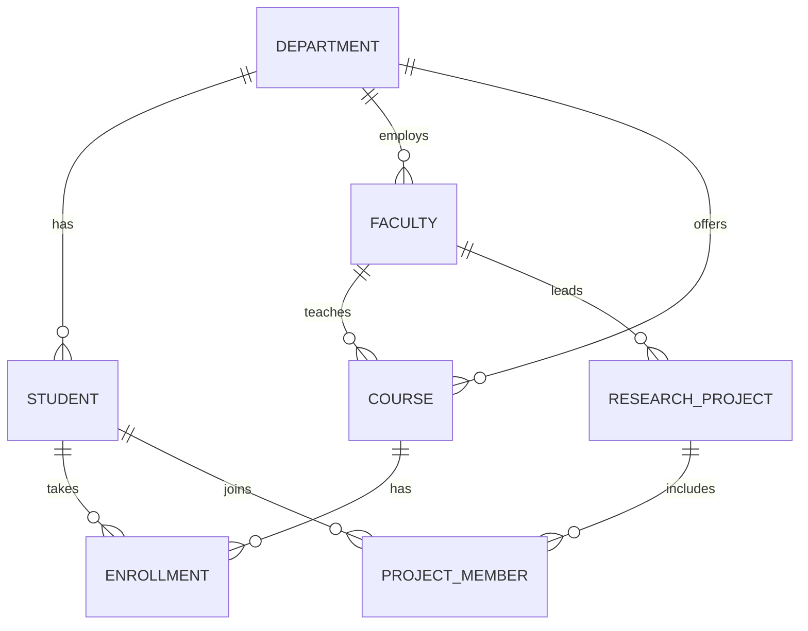

# Software Requirements Specification
## Centralized University Database Management System
Version 1.0

---

## 1. Introduction

### 1.1 Purpose
This document describes the requirements for a centralized database system that brings the administrative records of a college (students, faculty, departments, courses, enrollments) and its research cell into one place.

### 1.2 Scope
Right now every department keeps its own spreadsheets, which leads to duplicate records and no single view of a student. The system will:
- store all student, faculty, department and course data centrally,
- manage course enrollment and grading,
- track research projects and the students working on them,
- let any department query up-to-date data without emailing another department.

### 1.3 Definitions
| Term | Meaning |
|------|---------|
| SRS  | Software Requirements Specification |
| DAO  | Data Access Object |
| JDBC | Java Database Connectivity |
| Research cell | Group of faculty and students working on funded or internal research projects |

---

## 2. Overall Description

### 2.1 Product perspective
A Java console application (JDBC) talking to a MySQL database. It is designed so a GUI or web front end can reuse the DAO layer later.

### 2.2 User classes
- **Administrator** - manages departments, courses, faculty.
- **Registrar staff** - admits students, handles enrollment and grades.
- **Research coordinator** - creates projects and assigns student members.

### 2.3 Operating environment
Java 17+, MySQL 8.x, MySQL Connector/J.

### 2.4 Assumptions
- Each student belongs to exactly one department.
- A course is taught by at most one faculty member at a time.
- Semesters are identified by a string such as `2026-ODD`.

---

## 3. Functional Requirements

| ID | Requirement |
|----|-------------|
| FR-1 | The system shall allow adding, viewing, updating and deleting student records. |
| FR-2 | The system shall list students filtered by department. |
| FR-3 | The system shall store courses with code, title, credits, department and assigned faculty. |
| FR-4 | The system shall enroll a student in a course for a given semester and reject duplicates. |
| FR-5 | The system shall record a grade against an enrollment. |
| FR-6 | The system shall produce a transcript for any student. |
| FR-7 | The system shall produce a course roster for a given semester. |
| FR-8 | The system shall allow creating research projects with a lead faculty member. |
| FR-9 | The system shall allow adding student members to a project. |
| FR-10 | The system shall show all projects with lead, status and member count. |

## 4. Non-functional Requirements

| ID | Requirement |
|----|-------------|
| NFR-1 | **Integrity** - foreign keys and unique constraints enforce valid data at the database level. |
| NFR-2 | **Security** - all queries use prepared statements; DB credentials come from environment variables. |
| NFR-3 | **Performance** - common lookups (by department, by student) are indexed. |
| NFR-4 | **Maintainability** - database code is isolated in the DAO layer. |
| NFR-5 | **Normalization** - schema is in 3NF. |

---

## 5. Data Model

### 5.1 Entities
`department`, `faculty`, `student`, `course`, `enrollment`, `research_project`, `project_member`

### 5.2 Relationships
- Department 1 - N Student
- Department 1 - N Faculty
- Department 1 - N Course
- Faculty 1 - N Course (teaches)
- Student M - N Course, resolved by `enrollment`
- Faculty 1 - N ResearchProject (lead)
- Student M - N ResearchProject, resolved by `project_member`

### 5.3 ER diagram (Mermaid)

---

## 6. Use Cases (brief)

**UC-1 Enroll student** - Registrar picks a student, a course and a semester. System checks the pair isn't already enrolled and saves it. *Alt:* duplicate -> error message.

**UC-2 Enter grade** - Registrar selects an existing enrollment and records the grade.

**UC-3 Start research project** - Coordinator enters title and lead faculty; later adds student members.

---

## 7. Future Work
- Role-based login
- Prerequisites between courses
- Web/GUI front end
- CGPA calculation from grades and credits
